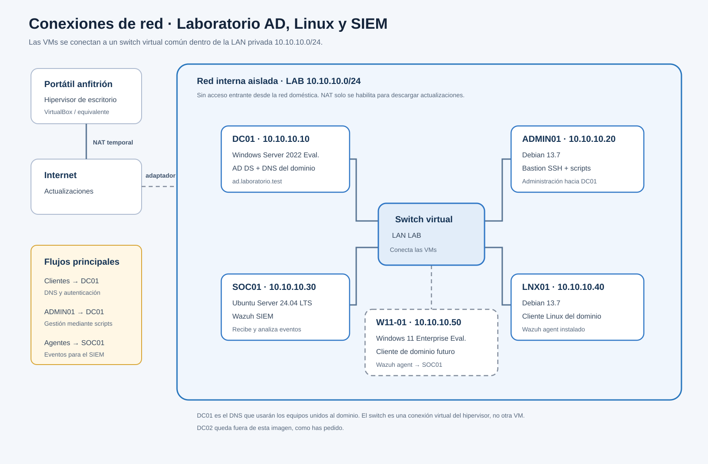

# Arquitectura
En esta seccion voy a explicar el disenio de la aruitectura del laboratorio y los sistemas operativos de los servidores. 

## Servidores
Este proyecto cuenta con cinco servidores, cada uno contara con una funcion diferente. Los distintose servidores son: **DC01, ADMIN01, SOC01, LNX01** y **W11-01**. Para los servidores usae **VMware WorkStation Pro**. 

| Maquina | SO | Funcion |
|---------|----|---------|
| DC01 | Windows Server 2022 Evaluation | Active Directory y DNS |
| ADMIN01 | Debian 13.7 | Bastion Host y servidor de administracion |
| LNX01 | Debian 13.7 | Cliente Linux unido al dominio, pruebas login y permisos |
| SOC01 | Ubuntu Server 24.04 LTS* | Contiene el SIEM y monitoriza |
| W11-01 | Windows 11 Enterprise Evaluation | Cliente Windows para generar eventos |

*Para SOC01 voy a usar Ubuntu Server en lugar de Debian porque en la documentacion de Wazuh no aparece Debian en la lista de SO para sus componentes centrales (manager, indexer y dashboard). 

## Topologia de red
La red LAN del proyecto es `10.10.10.0/24`. Las direcciones IP de los distintos servidores seran estaticas:
- **DC01** - `10.10.10.10`: Tiene Active Directory y DNS. Los equipose del dominio consultan este DNS para encontrar el controlador y y autenticarse.
- **ADMIN01** - `10.10.10.20`: Bastion Host para acceder a administrar los sistemas y ejecutar scripts. 
- **SOC01** - `10.10.10.30`: Recibe los eventos de autenticacion.
- **LNX01** - `10.10.10.40`: Cliente Linux del dominio que enviara eventos de autenticacion.
- **w11-01** - `10.10.10.50`: Cliente Windows del dominio que enciara eventos de autenticacion.

